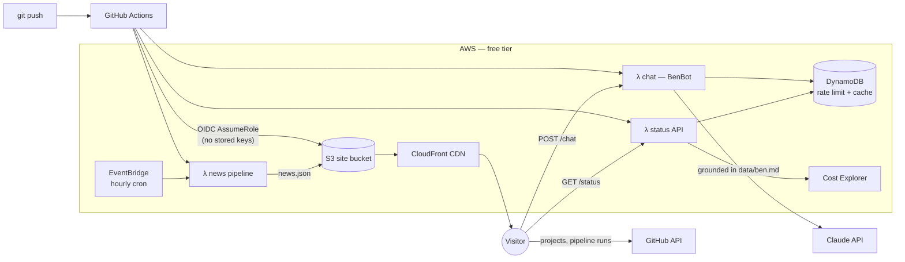

# Architecture — the portfolio *is* the production system

The core idea: instead of a static page *claiming* DevOps skills, this repo
**demonstrates** them. The site deploys itself, monitors itself, reports its
own cost, and answers questions about its owner with an LLM. Every number on
the Live Ops panel is real.

## Progressive enhancement — two hosting tiers

| | Tier 0 — GitHub Pages (now, $0) | Tier 1 — AWS (after `terraform apply`) |
|---|---|---|
| Hosting | GitHub Pages (`static.yml`) | S3 + CloudFront, OAC, HTTPS |
| Projects | live from GitHub API (browser) | same |
| Live Ops | real pipeline runs + commits (GitHub API) | + real AWS month-to-date cost, Lambda metrics |
| Chat | offline keyword mode (honest about it) | Claude on Lambda, grounded in `data/ben.md` |
| News | Hacker News Algolia API (browser) | hourly Lambda pipeline → `news.json` on the CDN |

The frontend never breaks when the backend is absent — `assets/js/config.js`
is the feature flag. That fallback design is itself a talking point in
interviews: graceful degradation, no single point of failure.

## Design decisions worth defending in an interview

1. **No JS framework, no build step.** ~30 KB of hand-written CSS/JS. Zero npm
   supply chain, zero dependabot noise, instant loads. Complexity is a cost;
   this page doesn't need React.
2. **Keyless CI/CD.** GitHub Actions federates into AWS via OIDC. There is no
   `AWS_SECRET_ACCESS_KEY` to leak, rotate, or forget.
3. **Zero-dependency Lambdas.** `urllib` instead of `requests`, no layers, no
   docker packaging. Cold starts stay ~100 ms and deploys are a zip file.
4. **Cost is an SLO.** Cost Explorer spend is displayed *publicly* on the site;
   an AWS Budget emails at 80% of $5. Rate limiting (DynamoDB TTL counters)
   bounds the only real variable cost — LLM tokens.
5. **The LLM is grounded, not vibes.** BenBot's system prompt embeds
   `data/ben.md` and instructs refusal for anything not in it. Editing that
   file *is* the retraining pipeline.
6. **One DynamoDB table.** Rate-limit counters and the status cache share a
   table with TTL — single-digit cents at portfolio traffic.

## Security posture
- S3 bucket fully private; only CloudFront (OAC + SourceArn condition) can read.
- Deploy role is scoped to: sync one bucket, invalidate one distribution,
  update three named functions — nothing else. Trust policy pins repo + branch.
- Chat API: CORS allow-list, 500-char input cap, per-IP rate limit, prompt
  hardened against "ignore your instructions".
- Cost Explorer calls (each costs $0.01!) are cached 6h in DynamoDB.

## Monthly cost estimate

| Component | Cost |
|---|---|
| S3 + CloudFront (PriceClass_100, portfolio traffic) | ~$0 (free tier) |
| 3 × Lambda + EventBridge + DynamoDB on-demand | ~$0 (free tier) |
| Claude Haiku tokens (rate-limited chat) | $0.50–$2 |
| Cost Explorer API (cached, ≤4 calls/day) | ≤ $1.20 |
| **Total** | **≈ $1–3 / month** |
